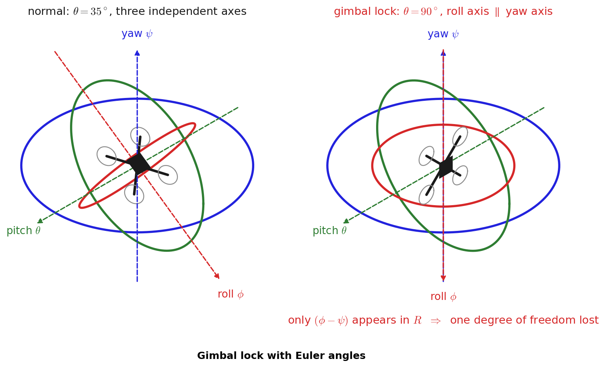
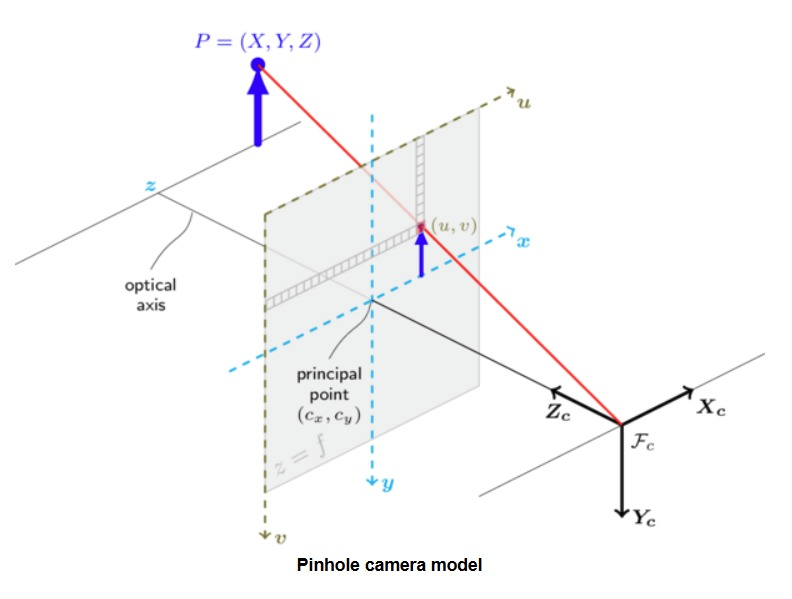
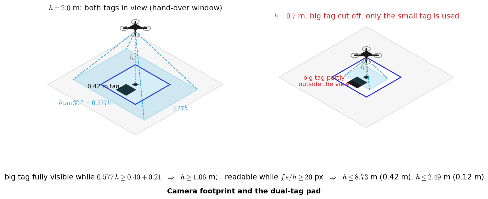
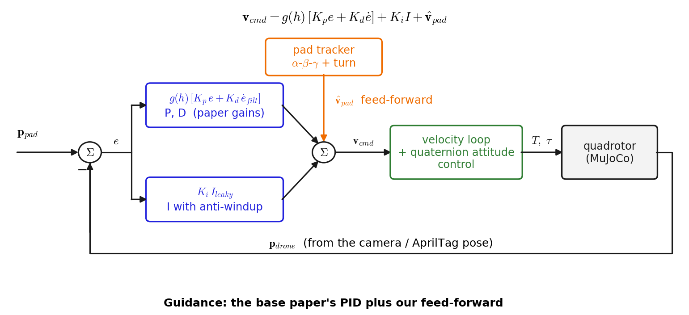
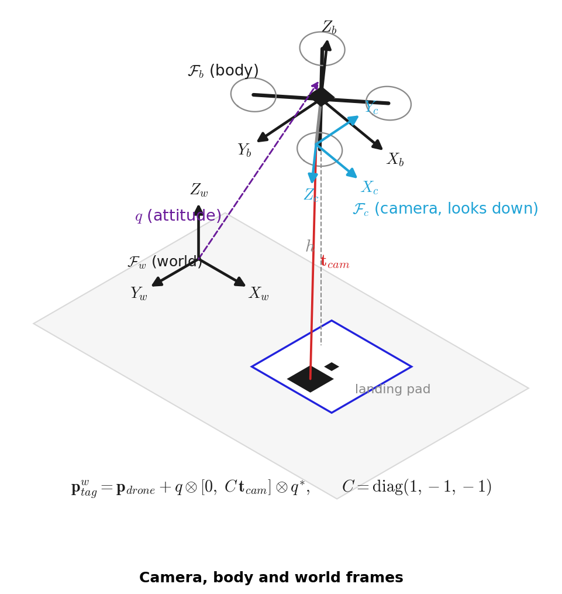
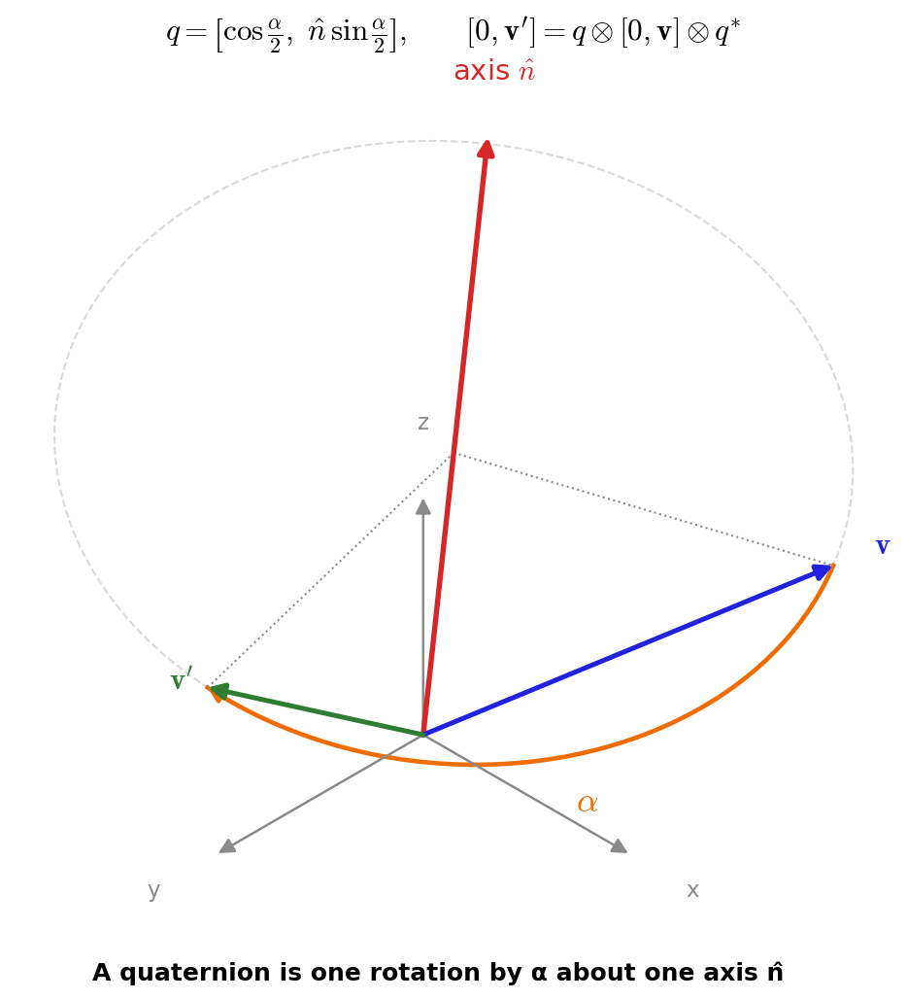
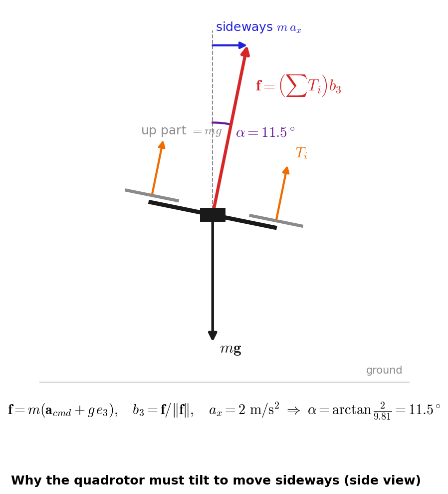

<p align="center">
  
</p>

<h1 align="center">Introduction to Data-Driven Control of Drones - 22AIE448</h1>

<h1 align="center">Autonomous Landing of Quadrotor UAV Using AprilTags Vision Positioning and Quaternion-based Attitude Representation </h1>

<h2 align="center">Project Video — Recording Script</h2>

### *Team Members*
Police Aryan - CB.SC.U4AIE24241\
Gayathri Vaishnav - CB.SC.U4AIE24337\
Rohit Vardhan  - CB.SC.U4AIE24231\
Sai Reddy - CB.SC.U4AIE24205\
Sairi Manvik - CB.SC.U4AIE24352

---

## Scene 1 — Introduction and Problem 
<p align="center"></p>

> "Good morning. This is our project for 22AIE448: *Autonomous Landing of a Quadrotor UAV using AprilTags Vision Positioning and Quaternion-based Attitude Representation*.
>
> Think of a delivery drone. GPS or an AirTag radio can bring it to the right street, but with an error of about two and a half metres, and the landing pad is only one and a half metres wide. So the last part of the flight must use vision.
>
> In our simulation there are ten addressed pads. Four are on the street, three are on moving vehicles — a van, a cart and a rover driving in circles — and three are on rooftops up to 7.5 metres high. You give the drone an address, and it flies there and lands on that exact pad.
>
> On the right of this picture you can see what the drone's own camera sees at 8 metres, 2 metres and 45 centimetres."

---

## Scene 2 — Base Paper and Our Contribution

<p align="center"></p>

> "Our base paper is Li et al., 2019, from the Chinese Control Conference. They put a large and a small AprilTag on a pad, find the tag's pose with a camera, and use a PID controller with gains 0.20, 0.03 and 0.35 to land a DJI M100.
>
> In this diagram, the **blue blocks are from the paper**, and the **orange blocks are what we added**: the AirTag radio stage, the address filter, the pad tracker, feed-forward and gain scheduling, and our own attitude loop."

<p align="center"></p>

<p align="center"></p>

> "Our main contribution is replacing the paper's Euler-angle rotation matrices with **unit quaternions** and the **Sandwich Operator**. Euler angles have two problems:
>
> - **Gimbal lock:** at 90 degrees of pitch, the roll axis lines up with the yaw axis and one degree of freedom is lost.
> - **Wrap-around:** if the drone faces 179 degrees and must face minus 179, subtracting angles says turn 358 degrees, when the real answer is 2 degrees.
>
> Quaternions have neither problem."

---

## Scene 3 — Seeing the Tag  

<p align="center"></p>

> "The first part is seeing the tag. A camera follows the pinhole model: a point at distance Z appears at pixel *u = cₓ + f·X/Z*. Things twice as far away look half as big. Our camera is 640 by 480 pixels with a 60-degree view, so its focal length is 240 divided by tan 30, which is 415.7 pixels."

<p align="center"></p>

> "A tag of size *s* at height *h* looks *f·s/h* pixels wide, and the detector needs about 20 pixels to read it. So the big 42-centimetre tag can be read up to 8.73 metres, and the small 12-centimetre tag up to 2.49 metres — these are points A and B on the graph."

<p align="center"></p>

<p align="center"></p>

> "That is why each pad has two tags. The big tag sits 40 centimetres off-centre, and below 1.06 metres it leaves the picture. So between 1.06 and 2.49 metres the drone hands over from the big tag to the small one.
>
> Very close to the ground, about 25 centimetres, even the small tag fills the whole image. We call this the decision height. Instead of climbing back up, the drone commits and lands, the way a pilot does at decision height. Each pad's tags have their own IDs, k and k plus 10, so the drone only lands on the pad it was sent to."

---

## Scene 4 — Predicting a Moving Pad 

<p align="center"></p>

> "The second part is predicting where a moving pad will be. A cricket fielder doesn't run to where the ball is; they run to where it will land.
>
> Our tracker is an alpha-beta-gamma filter. Every step it predicts the pad's position, compares it with the camera, and corrects by a fixed share of the surprise: 35 percent for position.
>
> If the pad is turning, its acceleration points sideways. From velocity and acceleration we get the turn rate: v cross a, divided by v squared. For the rover at address 5 that is 0.6 radians per second on a 0.9-metre circle. The drone then aims a quarter of a second ahead along the curve, not along a straight line."

<p align="center"></p>

> "Here is a real landing on the moving courier van. The offset shrinks to zero while the drone tilts to chase the pad."

---

## Scene 5 — Deciding Where to Fly 

<p align="center"></p>

> "The third part is guidance: deciding how fast the drone should fly. The paper uses a PID. P reacts to how far the pad is, I removes steady drift such as wind, and D brakes so the drone doesn't overshoot. It works very well for a pad that stands still."

<p align="center"></p>

> "But a PID can only make speed out of an error. To follow a van at 0.9 metres per second, it must stay 0.9 divided by 0.2 — that is 4.5 metres — behind. That's the red curve. The pad is only 1.5 metres wide, so the paper's controller landed on **zero out of six** moving pads.
>
> Our main fix is **feed-forward**. We add the pad's own speed from the tracker directly to the command, so the PID only fixes the small leftover. The gap goes to zero — the green curve."

<p align="center"></p>

> "We also raise the gain from 1 to 3 as the drone gets lower, because near the ground the camera sees a very small patch. And the drone may only descend inside a cone: the offset must be less than 0.22 times the height."

<p align="center"></p>

> "When we switched these on one at a time, moving-pad landings went from 0 out of 6, to 4 with feed-forward, to 6 out of 6 with the full controller. The static error dropped from 10.9 centimetres to 0.6."

---

## Scene 6 — Quaternions and Tilting the Drone

<p align="center"></p>

> "The fourth part is how we handle orientation. The camera measures the tag in its own frame. We turn it into the body frame with C, and into the world frame with the attitude quaternion q, using the Sandwich Operator: q times the vector times q-conjugate."

<p align="center"></p>

> "A quaternion is one turn about one axis — like a door on its hinge. It stores four numbers: the cosine of half the angle, and the sine of half the angle times the axis."

<p align="center"></p>

> "The last part is how the drone actually moves. Its propellers only push up out of its own top, so to move sideways it must lean. To accelerate at 2 metres per second squared, the thrust vector is 2 sideways and 9.81 up, which is a lean of 11.5 degrees.
>
> From the force we want, we build the target attitude q-desired using only vectors and no angles. The error is a single multiplication, q-conjugate times q-desired. If its first number is negative we flip the sign, which always picks the short way round. So 179 to minus 179 degrees becomes a 2-degree turn, not 358.
>
> The torque is J times K-R times the error, minus K-omega times the spin. With our gains of 130 and 22, the attitude settles in about 0.3 seconds without overshoot. We also use quaternion SLERP to smooth the pad's heading, which cut heading noise from 2.7 to 1.6 degrees."

---

## Scene 7 — Live Demo, Results and Conclusion  

<p align="center"></p>

**Run:**

```bash
run.bat 5
```

> "Here is the live MuJoCo simulation. On the left is the world, on the right the drone's own camera. We send it to address 5, the rover driving in circles. Watch it climb, transit on the radio fix, lock onto the tag, follow the rover around the curve, and land."

<p align="center"></p>

<p align="center"> </p>

> "We built the same model two more times, in MATLAB and in NetLogo, to make sure the result doesn't depend on one simulator."

<p align="center"></p>

| Platform | Landed | Mean error | Static pads | Moving pads |
|---|---|---|---|---|
| MuJoCo | 40 / 40 | 2.41 cm | 1.21 cm | 5.18 cm |
| MATLAB | 40 / 40 | 3.38 cm | 1.85 cm | 6.94 cm |
| NetLogo | 40 / 40 | 2.80 cm | 1.56 cm | 5.69 cm |
| **Total** | **120 / 120** | | | |

> "Across all three platforms the drone landed **120 out of 120** times. The mean errors are 2.4 centimetres in MuJoCo, 3.4 in MATLAB and 2.8 in NetLogo, on a 150-centimetre pad. Address 5, the circling rover, is the hardest on every platform: even perfect tracking leaves about 8 centimetres from the turn itself. Our future work is an IMM filter, and real flight tests.
>
> To conclude: we kept the base paper's pipeline and gains, replaced Euler angles with quaternions, and added feed-forward, gain scheduling and a turn-aware tracker. That turned a single-pad static lander into a drone that can land on street pads, rooftops and moving vehicles. Thank you."
