

  

<h1 align="center">Introduction to Data-Driven Control of Drones - 22AIE448</h1>

<h1 align="center">Autonomous Landing of Quadrotor UAV Using AprilTags Vision Positioning and Quaternion-based Attitude Representation </h1>

<h2 align="center">Final Project Report</h2>

### *Team Members*
Police Aryan - CB.SC.U4AIE24241\
Gayathri Vaishnav - CB.SC.U4AIE24337\
Rohit Vardhan  - CB.SC.U4AIE24231\
Sai Reddy - CB.SC.U4AIE24205\
Sairi Manvik - CB.SC.U4AIE24352

---

### Contents

1. Abstract
2. Introduction
3. Problem Statement and Objectives
4. Base Paper and Literature Survey
5. Base Paper Mathematics
6. Our Contribution
7. Mathematics of Our System
8. System Pipeline
9. Methodology and Implementation
10. Experimental Setup
11. Results
12. Discussion and Limitations
13. Conclusion and Future Work
14. References

---

## 1. Abstract

Autonomous landing is the most error-sensitive phase of quadrotor flight, and GPS alone cannot place a drone on a 1.5 m pad. This project simulates a delivery quadrotor that flies to one of **ten addressed landing pads** and lands on it. There are four pads on the street, three on moving vehicles and three on building roofs.

The method extends Li et al. (2019), who land on a single static pad using a monocular camera, two AprilTags of different sizes, Euler-angle rotation matrices and a fixed-gain PID. We keep their pipeline and gains, and add:

- **unit-quaternion attitude representation and control** with the Sandwich Operator, which removes gimbal lock and the ±180° wrap-around
- a **dual-scale tag geometry** with a derived hand-over window and a decision height
- a **PID with feed-forward, anti-windup and altitude gain scheduling**
- an **α-β-γ coordinated-turn tracker** for moving pads

The same model was implemented in MuJoCo (with real rendered camera images and a real AprilTag detector), MATLAB and NetLogo:

- It landed **120 of 120** missions, with mean touchdown errors of **2.41 cm, 3.38 cm and 2.80 cm** on the three platforms.
- On moving pads, the base paper's controller landed **0 of 6** times; the full controller landed **6 of 6**.

---

## 2. Introduction

---

## 3. Problem Statement and Objectives

**Problem.** Given a pad address $k\in\{1,\dots,10\}$, fly from the launch point to pad $k$ and touch down on its centre. Pad $k$ may be on the street, on a roof up to 7.5 m high, or on a moving vehicle (moving in a line at 0.7–0.9 m/s, or circling at 0.60 rad/s). The drone has wind gusts, a noisy radio fix and a real camera.

**Objectives.**

| # | Objective | How it is measured |
|---|---|---|
| O1 | Reproduce the base paper's pipeline (camera, dual tags, pose, PID with its gains) | Landing on static pads |
| O2 | Replace Euler-angle rotation matrices with unit quaternions throughout | No Euler angle used in the control loop; the 179° → −179° case handled as 2° |
| O3 | Read the pad at every height | Hand-over window and decision height derived and measured |
| O4 | Land on moving and turning pads | Moving-pad success rate and error |
| O5 | Check the result does not depend on one simulator | Same model on MuJoCo, MATLAB and NetLogo |

---

## 4. Base Paper and Literature Survey

### 4.1 Base paper

> Z. Li, Y. Chen, H. Lu, H. Wu, L. Cheng, "UAV Autonomous Landing Technology Based on AprilTags Vision Positioning Algorithm," *Proc. 38th Chinese Control Conference (CCC)*, Guangzhou, 2019, pp. 8148–8153. [IEEE Xplore](https://ieeexplore.ieee.org/document/8865757)

The paper's method:
- A DJI M100 with a Manifold computer and a monocular camera detects AprilTags with the detector of Olson (2011).
- It computes the tag pose by homography (DLT).
- It converts the pose through pixel, image, camera, world and body frames using Euler rotation matrices (its Eq. 1–8).
- A PID (its Eq. 9, with $k_p=0.20$, $k_i=0.03$, $k_d=0.35$) turns the offset into a velocity command for the DJI API.

The paper's reported results:
- The landing pad carries a large and a small tag.
- The large tag is used high up, and the small tag near the ground.
- The static landing error is reported as "less than 1%".
- While following a moving ground vehicle, the offset stays within (−0.2 m, +0.5 m).

### 4.2 Literature survey

<h3 align="center">Table 4.1</h3>

| # | Reference | Key idea | How we use it | Limitation |
|---|---|---|---|---|
| 1 | Li et al., CCC 2019 (base paper) | Dual-size AprilTags + PID landing on a real M100 | Full pipeline and PID gains reused | Euler matrices, fixed gains, one static pad |
| 2 | Olson, ICRA 2011 | AprilTag fiducial system | Marker family on every pad (tag36h11) | No multi-scale strategy |
| 3 | Wang & Olson, IROS 2016 | AprilTag 2, a faster detector with fewer false positives | Detector used through `pupil_apriltags` | Still needs about 20 px per tag |
| 4 | Collins & Bartoli, IJCV 2014 | IPPE: exact pose of a planar square | `solvePnP(IPPE_SQUARE)` | Two-fold ambiguity near frontal views |
| 5 | Fresk & Nikolakopoulos, ECC 2013 | Full quaternion attitude control | Justifies quaternion attitude control | No vision or landing logic |
| 6 | Lee, Leok & McClamroch, CDC 2010 | Geometric control: thrust vector → desired attitude | Our $b_3\to R_{des}\to q_{des}$ construction | Needs an accurate model |
| 7 | Shoemake, SIGGRAPH 1985 | SLERP on unit quaternions | Smoothing of the pad heading | Interpolation only |
| 8 | Falanga et al., SSRR 2017 | Vision landing on a moving platform | Motivates feed-forward and tracking | Needs relative-velocity estimation |
| 9 | Bar-Shalom, Li & Kirubarajan, 2001 | α-β-γ filters, coordinated turn, IMM | Our pad tracker; IMM as future work | A single model must switch |
| 10 | Todorov, Erez & Tassa, IROS 2012 | MuJoCo physics engine | Reference simulator | Simulation only |
| 11 | Wilensky, 1999 | NetLogo agent-based modelling | Third, independent implementation | Simplified rendering |

---

## 5. Base Paper Mathematics

**5.1 Pixel and image coordinates (paper Eq. 1–3).**

$$u=\frac{x}{dx}+u_0,\qquad v=\frac{y}{dy}+v_0$$

A point at $(x,y)$ mm on the sensor falls into pixel $(u,v)$. Here $dx$ is the pixel size and $(u_0,v_0)$ is the image centre. Combined with similar triangles, this gives the pinhole model $u=u_0+f\,X_c/Z_c$, where $f=F/dx$ is the focal length in pixels.

**5.2 Rotation matrices (paper Eq. 4–8).**

$$R=R_z(\alpha)\,R_y(\theta)\,R_x(\beta),\qquad P_c=R\,P_w+T$$

The world-to-camera transform is built from three single-axis rotations: yaw α, pitch θ and roll β.

**5.3 PID speed law (paper Eq. 9).**

$$V=k_p\,err+k_i\,integral+k_d\,(err-last\_err),\qquad k_p=0.20,\ k_i=0.03,\ k_d=0.35$$

**5.4 What we found when checking the paper's maths.** These points matter for our design:

- Eq. (5) prints $y'=x\sin\alpha+y\sin\alpha$. The correct form is $y'=x\sin\alpha+y\cos\alpha$.
- Eq. (6) is labelled $R_z(\alpha)$, but the printed matrix keeps x fixed, so it is $R_x$.
- Eq. (8) has three wrong entries. For example, entry (1,1) should be $\cos\theta\cos\alpha$, not $\sin\theta\cos\alpha$.
- Eq. (9): the D term is not divided by the sample time, so $k_d$ changes meaning with the frame rate.
- **Gimbal lock:** at $\theta=90^\circ$, Eq. (8) depends only on $\beta-\alpha$, so roll and yaw merge.
- **Lag on a moving pad:** a P term must keep an error $e=V_{pad}/k_p$ to produce the speed $V_{pad}$. For a van at 0.9 m/s this is $0.9/0.20=4.5$ m behind.

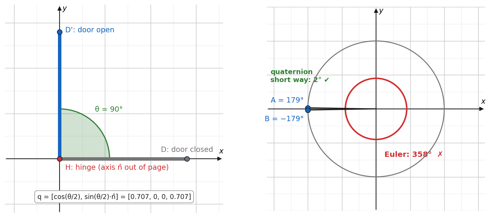

<i>Fig 5.1 — Left: a quaternion is one turn about one axis. Right: from 179° to −179°, Euler subtraction gives 358°, while the true turn is 2°.</i>

---

## 6. Our Contribution

| # | Contribution | What it solves |
|---|---|---|
| C1 | **Unit quaternions + Sandwich Operator** for all frames and for attitude control | No gimbal lock, no ±180° wrap-around, a single-product attitude error |
| C2 | **Addressed pads**: 10 pads, tag IDs k and k+10, radio-then-vision hand-off | Delivery to a chosen pad among many visible ones |
| C3 | **Dual-scale tag geometry**: read limits, hand-over window, decision height | Pad readable from 8.73 m down to touchdown |
| C4 | **Upgraded PID**: filtered D, leaky I, pad-velocity feed-forward, gain schedule $g(h)$ | Removes the 4.5 m moving-pad lag |
| C5 | **α-β-γ coordinated-turn tracker** | Predicts a turning vehicle 0.25 s ahead |
| C6 | **Three independent platforms** | Results do not depend on one simulator |

---

## 7. Mathematics of Our System

The maths is split into five parts, in the order the drone uses them: **See → Locate → Predict → Decide → Tilt**.

### 7.1 Seeing the tag (camera geometry)

$$f=\frac{240}{\tan30^\circ}=415.7\ \text{px},\qquad \text{size in pixels}=\frac{f\,s}{h}\ge20\ \Rightarrow\ h_{max}=\frac{f\,s}{20}$$

| Tag | Edge $s$ | Readable up to | Leaves the image below |
|---|---|---|---|
| Large (ID k, 0.40 m off-centre) | 0.42 m | **8.73 m** | **1.06 m**, from $0.577h\ge0.40+0.21$ |
| Small (ID k+10, at the centre) | 0.12 m | **2.49 m** | the decision height |

The hand-over window is **1.06–2.49 m**, where both tags can be read. The **decision height** is where even the small tag, with its white border, no longer fits in the image:

$$h_{blind}=0.12+\frac{0.075+e}{\tan30^\circ}=0.25+1.73\,e\ \text{m}$$

Here $e$ is the drone's horizontal offset from the pad centre. Measured against the real detector, the limit is $0.23+1.55e$, so the formula is on the safe side.

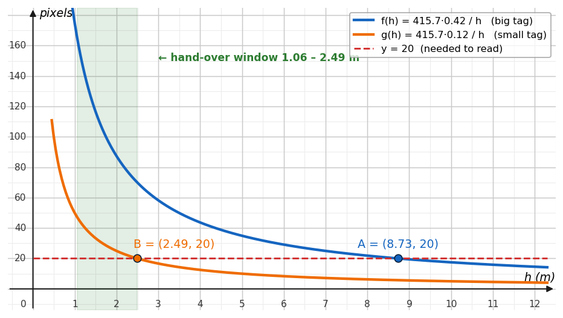

<i>Fig 7.1 — The tag's size in the image falls as f·s/h. Each tag is readable down to the 20 px line.</i>

### 7.2 Locating the pad (pose and quaternion frames)

1. **Pose:** `solvePnP(IPPE_SQUARE)` on the 4 corners gives the tag position $t$ in the camera frame.
2. **Quaternion:** $q=[\cos\frac{\theta}{2},\ \hat n\sin\frac{\theta}{2}]$, with $\lVert q\rVert=1$. Its conjugate is $q^*=[w,-x,-y,-z]$.
3. **Hamilton product:** $q\otimes r=[q_0r_0-\vec q\cdot\vec r,\ q_0\vec r+r_0\vec q+\vec q\times\vec r]$.
4. **Sandwich Operator:** $[0,v']=q\otimes[0,v]\otimes q^*$, which moves the tag position camera → body → world.
5. **Pad centre:** $c_{pad}=p_{tag}-R_z(\psi_{pad})[0.40,0]^T$.
6. **Heading smoothing:** SLERP, $\mathrm{slerp}(q_a,q_b,t)=\frac{\sin((1-t)\Omega)}{\sin\Omega}q_a+\frac{\sin(t\Omega)}{\sin\Omega}q_b$.

**Worked example.** Rotating east $(1,0,0)$ by $q=[0.707,0,0,0.707]$ (90° about z):
- $q\otimes[0,1,0,0]=[0,0.707,0.707,0]$
- $\otimes\,q^*$ gives $[0,0,1,0]$, which is north ✔

### 7.3 Predicting a moving pad (tracker)

$$p^-=\hat p+\hat v\Delta t+\tfrac12\hat a\Delta t^2,\quad r=z-p^-,\quad \hat p=p^-+\alpha r,\quad \hat v=v^-+\tfrac{\beta}{\Delta t}r,\quad \hat a=\hat a+\tfrac{2\gamma}{\Delta t^2}r$$

The gains are $\alpha=0.35$, $\beta=0.08$ and $\gamma=0.010$. The turn rate is:

$$\Omega=\frac{(\hat v\times\hat a)_z}{\lVert\hat v\rVert^2}$$

It is trusted only when the pad moves faster than 0.30 m/s **and** $|\sin\angle(v,a)|>0.55$. The aim point is predicted **0.25 s ahead along the arc**.

**Example (address 5):** $v=(0.54,0)$ and $a=(0,0.324)$ give $\Omega=0.60$ rad/s and a radius of 0.9 m ✔

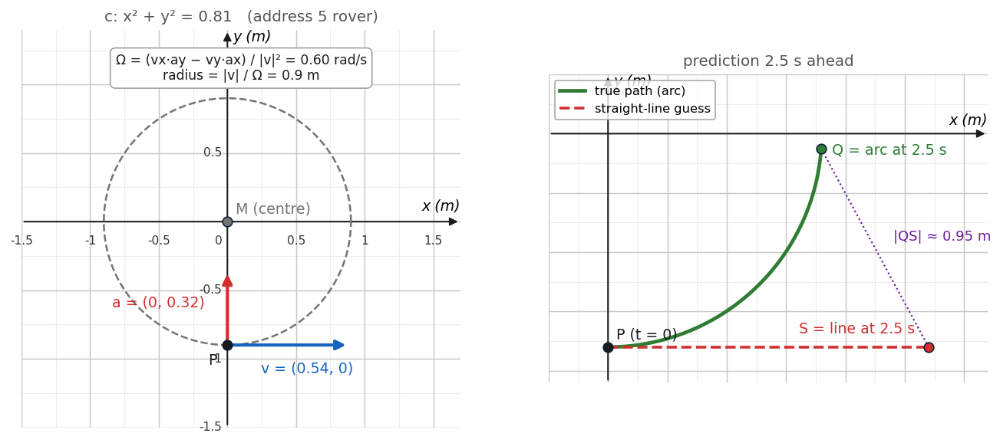

<i>Fig 7.2 — Turn rate from velocity and acceleration, and why predicting along the arc beats a straight line.</i>

### 7.4 Deciding where to fly (guidance)

$$v_{cmd}=g(h)\big[k_p e+k_d\dot e_{filt}\big]+k_i I_{leaky}+\hat v_{pad}$$

- **Filtered derivative:** $\dot e=(e_k-e_{k-1})/\Delta t$, passed through a low-pass filter with $\tau=0.12$ s.
- **Leaky integral:** collects only when $|e|<0.6$ m and is clipped at ±1.2. If $I\cdot e<0$, then $I\leftarrow I(1-\Delta t/0.6)$.
- **Gain schedule:** $g(h)=1$ above 4 m, $1+2(4-h)/3.4$ in between, and 3 below 0.6 m. It multiplies only P and D.
- **Feed-forward:** $\hat v_{pad}$ from the tracker. In steady state the bracket goes to zero, so $e_{ss}=0$ instead of $V_{pad}/k_p$.
- **Descent cone:** descend only while $\lVert e\rVert<0.22h$. Below $h_{blind}$, commit to landing.

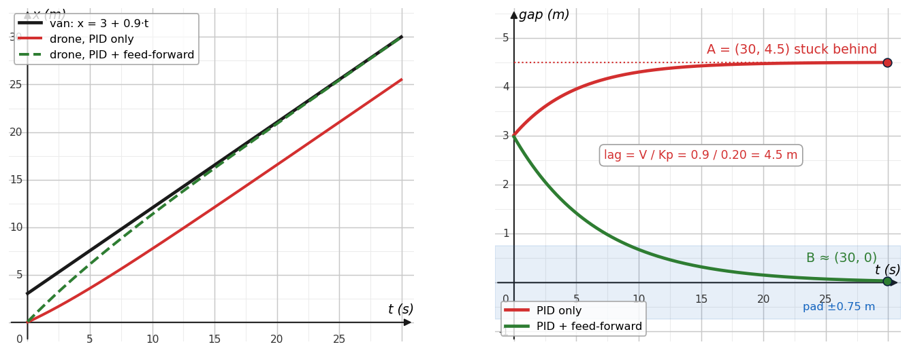

<i>Fig 7.3 — Chasing a van at 0.9 m/s. With the PID alone the drone settles 4.5 m behind; with feed-forward the gap goes to zero.</i>

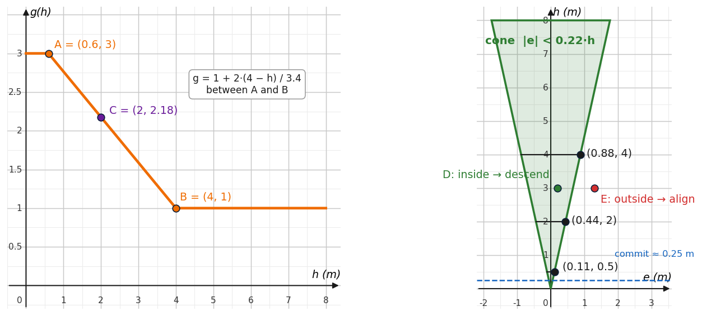

<i>Fig 7.4 — The gain schedule g(h), and the descent cone |e| < 0.22h.</i>

### 7.5 Tilting the drone (quaternion attitude control)

$$a_{cmd}=1.6\,(v_{cmd}-v)+1.2\!\int(v_{cmd}-v)\,dt,\qquad f=m(a_{cmd}+g e_3),\qquad b_3=\frac{f}{\lVert f\rVert}$$

$$b_2=\frac{b_3\times c_1}{\lVert b_3\times c_1\rVert},\quad b_1=b_2\times b_3,\quad R_{des}=[b_1\,b_2\,b_3]\to q_{des}\ \ (\text{Shepperd})$$

$$q_{err}=q^*\otimes q_{des}\ (\text{flip if }w<0),\quad e_R=2\,\mathrm{atan2}(\lVert\vec q\rVert,w)\frac{\vec q}{\lVert\vec q\rVert},\quad \tau=J(K_Re_R-K_\omega\omega),\quad T=f\cdot b_3^{now}$$

The gains are $K_R=130$ and $K_\omega=22$ for roll and pitch, and 30 and 12 for yaw. The model is $\dot q=\tfrac12q\otimes[0,\omega]$, renormalised after every step.

**Checks:**
- A 2 m/s² sideways acceleration needs a tilt of $\arctan(2/9.81)=11.5^\circ$.
- The linearised loop $\ddot\phi+22\dot\phi+130\phi=130\phi_d$ has $\omega_n=11.4$ rad/s and $\zeta=0.97$, so it settles without overshoot.
- 179° → −179°: $q_{err}=[-0.9998,0,0,-0.0175]$ flips to $[0.9998,0,0,0.0175]$, which is a 2° turn ✔

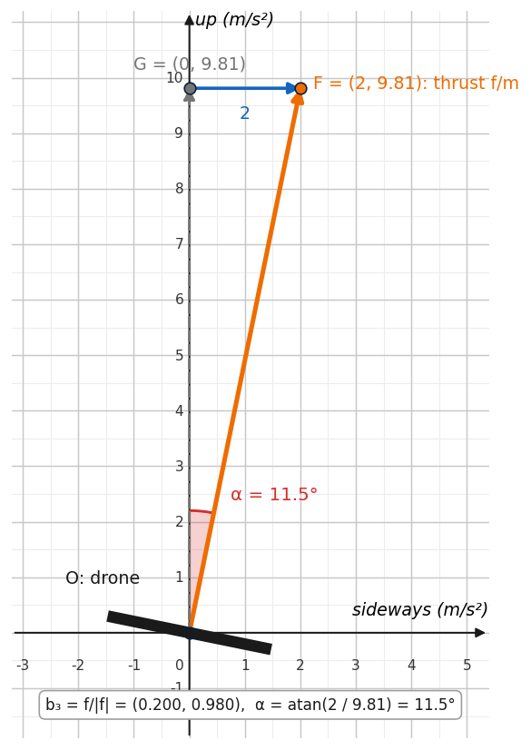

<i>Fig 7.5 — To move sideways the thrust axis must lean: f/m = (2, 9.81) gives an 11.5° tilt.</i>

---

## 8. System Pipeline

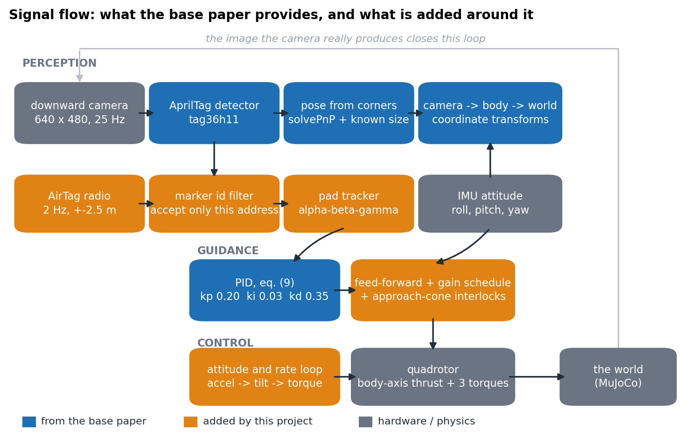

<i>Fig 8.1 — Signal flow. Blue blocks are from the base paper, orange blocks are added by this project, and grey blocks are hardware and physics.</i>

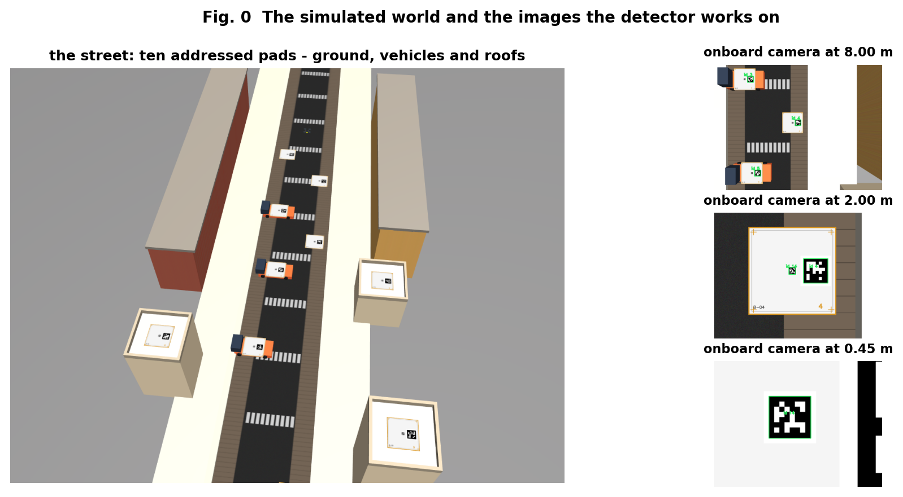

<i>Fig 8.2 — The simulated street with ten addressed pads, and the onboard camera images the detector works on.</i>

---

## 9. Methodology and Implementation

### 9.1 Mission phases

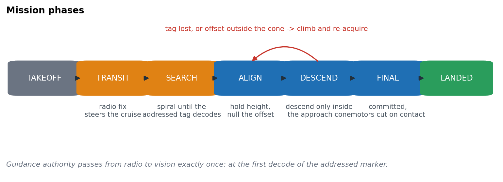

<i>Fig 9.1 — TAKEOFF → TRANSIT → SEARCH → ALIGN → DESCEND → FINAL → LANDED.</i>

| Phase | What happens | Leaves when |
|---|---|---|
| TAKEOFF | Climb to the 8 m search altitude | Altitude reached |
| TRANSIT | Fly on the radio fix (2 Hz, ±2.5 m) | Near the address |
| SEARCH | Spiral until the **addressed** tag (k or k+10) decodes | First decode: guidance switches from radio to vision, once |
| ALIGN | Hold height, null the offset | Offset < 0.45 m, held for 0.7 s |
| DESCEND | Descend inside the cone $\lVert e\rVert<0.22h$ | Final altitude / decision height |
| FINAL | Commit; sink at 0.35 m/s | Contact; motors cut |
| (go-around) | Tag lost or offset outside the cone, above $h_{blind}$ → climb and re-acquire | At most 2 times |

### 9.2 Pad design

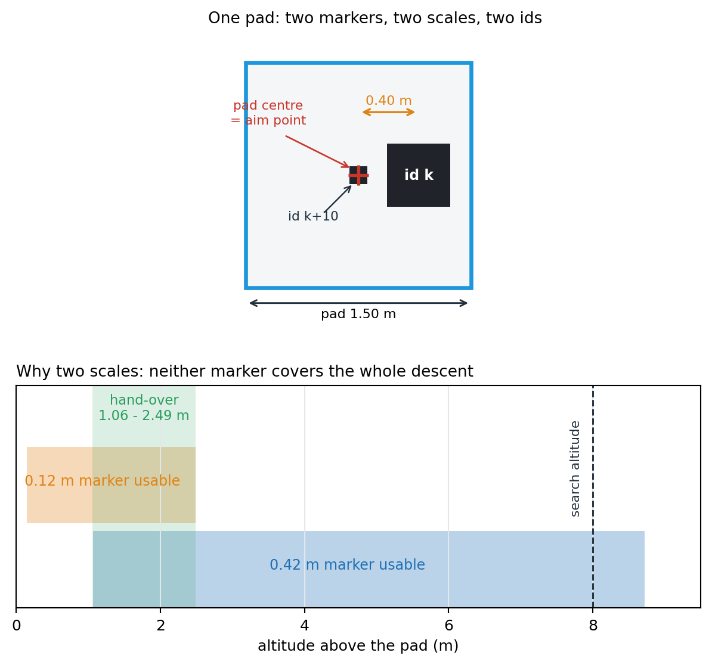

<i>Fig 9.2 — One pad has two markers, two scales and two IDs.</i>

### 9.3 Implementation on three platforms

| Platform | Files | What is real |
|---|---|---|
| **MuJoCo (Python, reference)** | `drone_sim/` — `physics/quad.py`, `perception/vision.py`, `perception/beacon.py`, `control/guidance.py`, `control/attitude.py`, `control/quaternion.py`, `mission.py` | Rigid-body physics at 500 Hz, rendered camera images, real `pupil_apriltags` decoding and `solvePnP` |
| **MATLAB** | `matlab/simulate_landing.m`, `quatlib.m`, `run_demo3d.m`, `run_batch.m`, `run_ablation.m` | The same equations, gains and pads, with a modelled camera; 3-D animation |
| **NetLogo** | `netlogo/drone_airtag_landing.nlogo` (`code_part1–5.nls`) | The same model as agents; interactive address buttons |

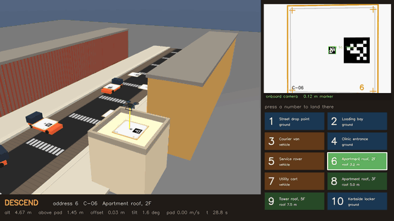

<i>Fig 9.3 — MuJoCo: the world view, the drone's own camera, and the ten address buttons.</i>

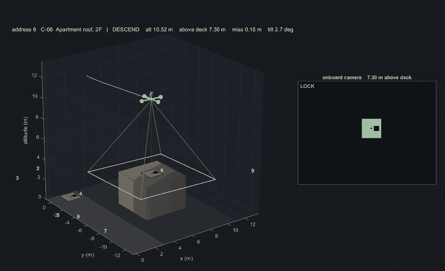 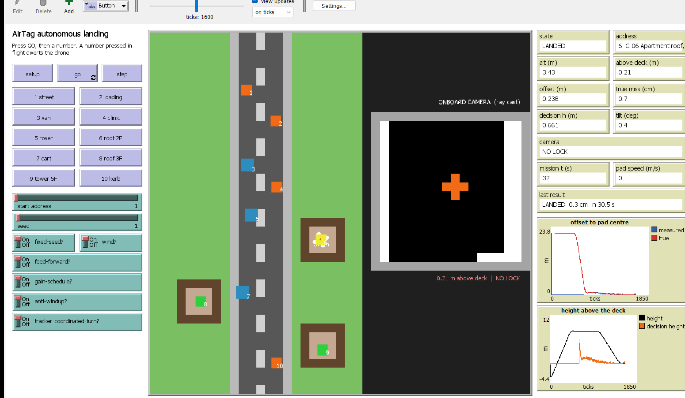

<i>Fig 9.4 — MATLAB 3-D animation (left) and the NetLogo model (right).</i>

---

## 10. Experimental Setup

| Item | Value |
|---|---|
| Drone | 3.5 kg, inertia diag(0.045, 0.045, 0.080) kg·m², thrust-to-weight 2.2, motor lag 40 ms, tilt limit 25° |
| Loops | Physics 500 Hz, control 100 Hz, camera 25 Hz |
| Camera | 640×480, 60° vertical FOV, f = 415.7 px, mounted 0.12 m below the centre of mass |
| Tags | tag36h11; 0.42 m (ID k) and 0.12 m (ID k+10); pad 1.5 m |
| Disturbances | Wind (0.6, −0.4) m/s + gusts σ = 0.5 m/s (τ = 1.5 s); attitude noise 0.6°; rangefinder noise 3 cm; radio fix ±2.5 m |
| Pads | 1, 2, 4, 10 on the street · 3 van (line, 0.9 m/s) · 5 rover (circle r = 0.9 m, 0.60 rad/s) · 7 cart (line, 0.7 m/s) · 6, 8, 9 roofs at 3.2, 5.0 and 7.5 m |
| Missions | 10 addresses × 4 random seeds = 40 per platform |
| Metric | Horizontal distance from the drone to the pad centre at touchdown |

---

## 11. Results

### 11.1 Three platforms, one model

<h3 align="center">Table 11.1</h3>

| Platform | Landed | Mean | Static pads | Moving pads | Mean time | Worst address |
|---|---|---|---|---|---|---|
| MuJoCo | 40 / 40 | 2.41 cm | 1.21 cm | 5.18 cm | 33.0 s | 5 |
| MATLAB | 40 / 40 | 3.38 cm | 1.85 cm | 6.94 cm | 32.6 s | 5 |
| NetLogo | 40 / 40 | 2.80 cm | 1.56 cm | 5.69 cm | 33.3 s | 5 |
| **Total** | **120 / 120** | | | | | |

Further MuJoCo figures:
- median error 1.40 cm
- 95th percentile 8.34 cm
- maximum 10.95 cm
- mean touchdown sink rate 0.14 m/s

### 11.2 Per address (MuJoCo, 4 runs each)

<h3 align="center">Table 11.2</h3>

| Address | Pad | Type | Landed | Mean error |
|---|---|---|---|---|
| 1 | Street drop point | street | 4/4 | 1.05 cm |
| 2 | Loading bay | street | 4/4 | 1.44 cm |
| 3 | Courier van | moving (line) | 4/4 | 3.64 cm |
| 4 | Clinic entrance | street | 4/4 | 0.53 cm |
| 5 | Service rover | moving (circle) | 4/4 | 8.19 cm |
| 6 | Apartment roof, 2F | roof 3.2 m | 4/4 | 1.30 cm |
| 7 | Utility cart | moving (line) | 4/4 | 3.72 cm |
| 8 | Apartment roof, 3F | roof 5.0 m | 4/4 | 1.54 cm |
| 9 | Tower roof, 5F | roof 7.5 m | 4/4 | 1.43 cm |
| 10 | Kerbside locker | street | 4/4 | 1.21 cm |

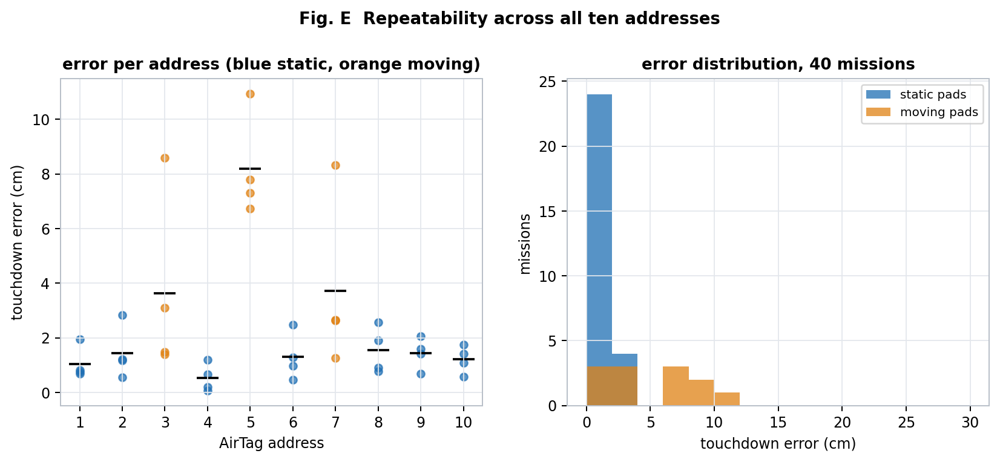

<i>Fig 11.1 — Repeatability across all ten addresses (blue static, orange moving).</i>

### 11.3 Static and moving landings

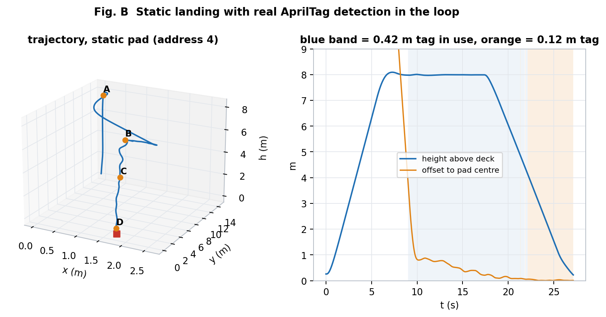

<i>Fig 11.2 — A static landing with real AprilTag detection in the loop. The blue band is where the 0.42 m tag is in use, and the orange band is where the 0.12 m tag is.</i>

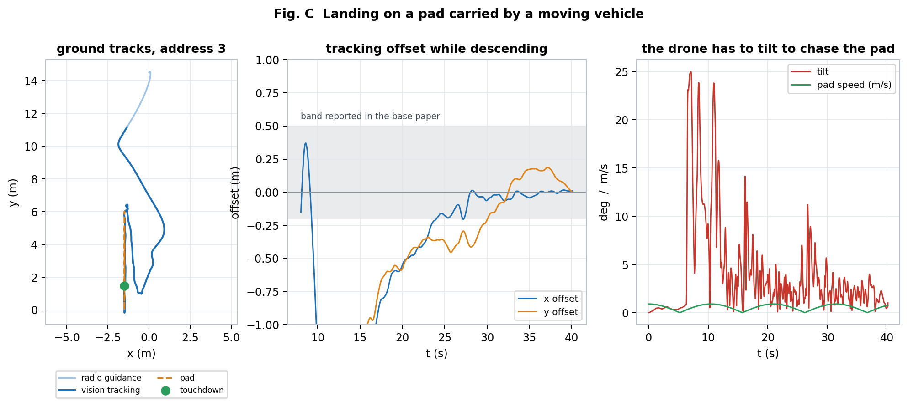

<i>Fig 11.3 — Landing on the moving courier van (address 3). The offset converges inside the band reported by the base paper, while the drone tilts to chase the pad.</i>

### 11.4 Ablation — what each addition is worth

<h3 align="center">Table 11.3 (MuJoCo, 6 runs per row)</h3>

| Controller | Moving landed | Moving error | Static error |
|---|---|---|---|
| Base paper PID only | **0 / 6** | — | 10.9 cm |
| + integral anti-windup | 0 / 6 | — | 2.3 cm |
| + pad-velocity feed-forward | 4 / 6 | 8.9 cm | 1.8 cm |
| + altitude gain scheduling | **6 / 6** | 6.5 cm | 0.9 cm |
| + coordinated-turn tracker (full) | **6 / 6** | **3.1 cm** | **0.6 cm** |

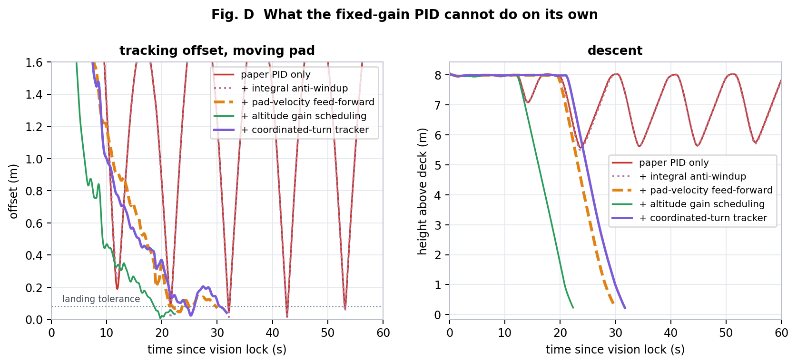

<i>Fig 11.4 — With the paper's PID alone (red), the drone keeps losing the moving pad and climbing back up. Each addition brings it down sooner and closer.</i>

### 11.5 Perception and addressing

- **Vision vs ground truth** (90 samples):
  - 86.7% of frames decoded
  - mean pad-centre error 6.9 cm (8.2 cm with the large tag, 4.8 cm with the small tag)
  - this is far better than the 250 cm radio fix
- **Addressing:** at search altitude the camera usually sees one to three pads at once (Fig 11.6). The ID filter (k or k+10) picks the right one.
- **Divert test:** changing the address mid-flight gave 20/20 landings, a mean error of 2.94 cm and no go-arounds.
- **SLERP:** heading noise fell from 2.7° to 1.6°, and pad-centre noise from 1.9 cm to 1.1 cm.

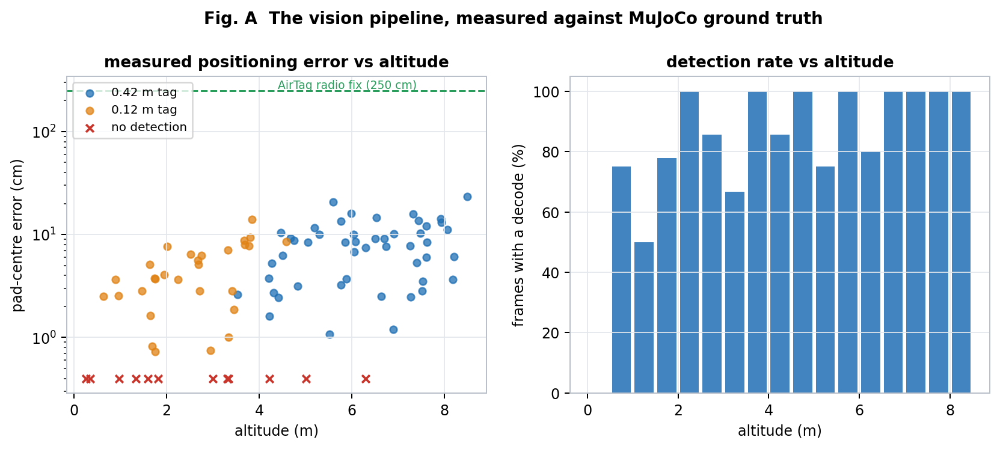

<i>Fig 11.5 — The vision pipeline measured against MuJoCo ground truth.</i>

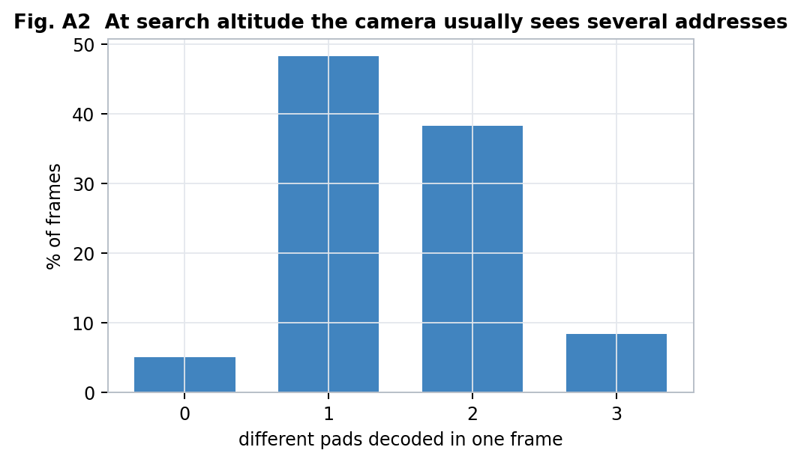

<i>Fig 11.6 — At search altitude the camera usually sees several addresses, so the ID filter is necessary.</i>

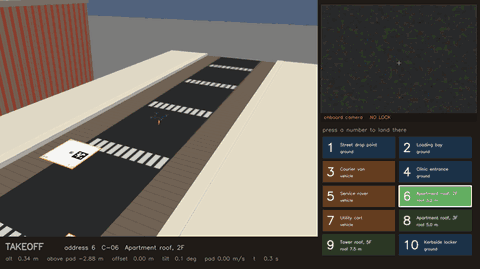

<i>Fig 11.7 — MuJoCo landing demo.</i>

---

## 12. Discussion and Limitations

- **Quaternions paid off where Euler angles fail.** The circling rover (address 5) crosses ±180° heading on every lap. The quaternion error with its sign check turns 179° → −179° into a 2° correction, with no special wrap-around code.
- **Feed-forward was the decisive guidance change.** It took moving-pad landings from 0/6 to 4/6, and the gain schedule completed it to 6/6. This matches the steady-state derivation $e_{ss}=V_{pad}/k_p$ for the PID alone.
- **The three platforms agree.** All three landed 120/120, with the same ranking of pads and the same worst address. MATLAB's errors are about 1 cm larger and NetLogo's are in between, which is consistent with their simpler camera models.
- **Limitation: address 5.** An unpredicted centripetal acceleration over the last ~0.7 s of descent gives about $\tfrac12\Omega^2rt^2=\tfrac12(0.6)^2(0.9)(0.7)^2\approx8$ cm, even with good tracking. The diagnostic flights showed:
  - when the turn-rate estimate was still active at commit, the mean miss was **8.8 cm** (7 of 12 flights)
  - when it had dropped out, the mean miss was **23.5 cm** (5 of 12 flights)
- **Simulation only.** Real flights would add lighting changes, motion blur, tag wear and estimator drift.

---

## 13. Conclusion and Future Work

We reproduced the AprilTag landing pipeline of Li et al. (2019) and extended it into an addressed delivery system that lands on street pads, rooftops and moving vehicles. The extensions were:

- unit-quaternion attitude representation and control with the Sandwich Operator
- a derived dual-tag geometry with a decision height
- a feed-forward, gain-scheduled PID
- a coordinated-turn tracker

The system landed **120 / 120** missions across MuJoCo, MATLAB and NetLogo, with mean errors of 2.4–3.4 cm on a 1.5 m pad. Moving-pad landings went from 0/6 with the base paper's PID to 6/6.

**Future work:**
1. An IMM filter that runs straight and turning models together, to keep the turn estimate alive at commit.
2. Real flight tests on a quadrotor with the same printed pads.
3. Robustness to lighting, blur and partial occlusion of the tags.

---

## 14. References

<h3 align="center">Table 14.1</h3>

| # | Reference | Link |
|---|---|---|
| 1 | Z. Li, Y. Chen, H. Lu, H. Wu, L. Cheng, "UAV Autonomous Landing Technology Based on AprilTags Vision Positioning Algorithm," CCC 2019 | [IEEE Xplore](https://ieeexplore.ieee.org/document/8865757) |
| 2 | E. Olson, "AprilTag: A Robust and Flexible Visual Fiducial System," ICRA 2011 | [IEEE Xplore](https://ieeexplore.ieee.org/document/5979561) · [Free PDF (UMich)](https://april.eecs.umich.edu/pdfs/olson2011a.pdf) |
| 3 | J. Wang, E. Olson, "AprilTag 2: Efficient and Robust Fiducial Detection," IROS 2016 | [DOI](https://doi.org/10.1109/IROS.2016.7759617) |
| 4 | T. Collins, A. Bartoli, "Infinitesimal Plane-Based Pose Estimation," IJCV 2014 | [DOI](https://doi.org/10.1007/s11263-014-0725-5) |
| 5 | E. Fresk, G. Nikolakopoulos, "Full Quaternion Based Attitude Control for a Quadrotor," ECC 2013 | [Google Scholar](https://scholar.google.com/scholar?q=Full+Quaternion+Based+Attitude+Control+for+a+Quadrotor+Fresk+Nikolakopoulos) |
| 6 | T. Lee, M. Leok, N. H. McClamroch, "Geometric Tracking Control of a Quadrotor UAV on SE(3)," CDC 2010 | [DOI](https://doi.org/10.1109/CDC.2010.5717652) |
| 7 | K. Shoemake, "Animating Rotation with Quaternion Curves," SIGGRAPH 1985 | [DOI](https://doi.org/10.1145/325165.325242) |
| 8 | D. Falanga, A. Zanchettin, A. Simovic, J. Delmerico, D. Scaramuzza, "Vision-Based Autonomous Quadrotor Landing on a Moving Platform," SSRR 2017 | [IEEE Xplore](https://ieeexplore.ieee.org/document/8088164) · [Free PDF (UZH RPG)](http://rpg.ifi.uzh.ch/docs/SSRR17_Falanga.pdf) |
| 9 | Y. Bar-Shalom, X. R. Li, T. Kirubarajan, *Estimation with Applications to Tracking and Navigation*, Wiley 2001 | [DOI](https://doi.org/10.1002/0471221279) |
| 10 | E. Todorov, T. Erez, Y. Tassa, "MuJoCo: A Physics Engine for Model-Based Control," IROS 2012 | [DOI](https://doi.org/10.1109/IROS.2012.6386109) |
| 11 | U. Wilensky, NetLogo, Northwestern University, 1999 | [NetLogo](https://ccl.northwestern.edu/netlogo/) |
